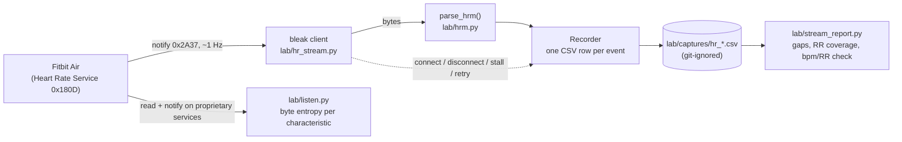

# pulse

Bluetooth LE lab tools for the Google Fitbit Air: discover the band, dump its
GATT table, record the standard Heart Rate stream to CSV with explicit
reconnection events, and check whether the recording is good enough to build on.

This is phase 0 of a larger plan (a personal recovery/strain app on top of the
band, see [`docs/brief.md`](docs/brief.md)). Only the lab tools exist today.

## Why

Before designing any recovery metric you need to know what the hardware
actually gives you, not what the spec sheet suggests. The first question was
binary: does the Air send RR intervals over the standard Heart Rate Service? If
yes, live HRV is possible; if no, every HRV feature depends on the cloud API or
on the proprietary protocol. These tools answer that question with data, and
the answer is documented in [`docs/ble.md`](docs/ble.md).

## Quickstart

Requires Python 3.10+ and a machine with Bluetooth LE (developed on macOS,
where device IDs are CoreBluetooth UUIDs rather than MAC addresses). On the Air,
enable "Share heart rate" in the Google Health app, otherwise it does not
advertise the Heart Rate Service.

```sh
pip install -r requirements.txt

python -m lab.ble_scan                       # list nearby devices; "HR" marks 0x180D advertisers
python -m lab.ble_scan --connect <ID>        # full GATT dump -> lab/captures/gatt_<ts>.json
python -m lab.hr_stream --minutes 10         # HR + RR -> lab/captures/hr_<ts>.csv
python -m lab.stream_report lab/captures/hr_<ts>.csv   # exit criterion: PASS/FAIL, exit code 0/1
python -m lab.listen --id <ID> --seconds 120 --label "idle on wrist"   # passive listen on proprietary services

python -m pytest lab/tests                   # 8 tests, no hardware needed
```

`hr_stream` also works with any other device that implements the standard
Heart Rate Service (chest straps, watches in broadcast mode).

## How it works



**Parsing 0x2A37** (`lab/hrm.py`). Byte 0 is a flag field: bit 0 selects a
`uint8` or `uint16` heart rate, bits 1-2 encode sensor contact (supported and
detected / supported and not detected / not supported, reported as `True` /
`False` / `None`), bit 3 announces a `uint16` energy-expended field in kJ, and
bit 4 announces zero or more `uint16` RR intervals in units of 1/1024 s. Each
RR value is converted to milliseconds:

$$
\mathrm{RR}_{\mathrm{ms}} = \mathrm{raw} \cdot \frac{1000}{1024}
$$

An odd number of trailing RR bytes or a payload shorter than 2 bytes raises
`ValueError`; the recorder logs it as a `malformed` event instead of crashing.

**Recording without hiding gaps** (`lab/hr_stream.py`). Every CSV row is an
event with both a UTC wall-clock time and a monotonic timestamp. Besides
`data` rows, the recorder writes `connect`, `disconnect` (remote or local),
`stall`, `retry` and `malformed`. A connection is declared stalled after
10 s without notifications (30 s for the first notification after connecting,
which can wait for in-app confirmation). Reconnection uses exponential
backoff, $t_k = \min(2^k, 15)$ s, reset after each successful connection.

**Checking the recording** (`lab/stream_report.py`). Let $t_1 < \dots < t_N$
be the monotonic timestamps of `data` rows. A gap is any interval with
$t_{i+1} - t_i > 3$ s. A gap is *handled* if a `disconnect`, `stall` or `retry`
event falls inside $[t_i, t_{i+1}]$, otherwise *unhandled*. The phase-0 exit
criterion is

$$
t_N - t_1 \ge 600\ \mathrm{s} \quad \wedge \quad \#\{\text{unhandled gaps}\} = 0 .
$$

The report also checks internal consistency between the two quantities the
band reports. With RR values restricted to the physiological range
300-2000 ms,

$$
\Delta = \frac{60\,000}{\overline{\mathrm{RR}}_{\mathrm{ms}}} - \overline{\mathrm{bpm}},
$$

which should be close to zero if the RR intervals and the bpm describe the
same beats. "Live HRV possible" is reported only if RR intervals appear in
more than 50% of notifications.

**Probing proprietary services** (`lab/listen.py`). The listener reads every
readable non-standard characteristic and subscribes to every notify/indicate
one. The only write it performs is the standard CCCD subscription (0x2902).
For each characteristic it reports payload lengths and the Shannon entropy of
the concatenated bytes,

$$
H = -\sum_{b=0}^{255} p_b \log_2 p_b \quad [\text{bit/byte}],
$$

where values close to 8 on long payloads suggest encrypted or compressed data.

## Findings so far

All from the author's own device; raw captures are not published.

- The Air advertises 0x180D only with "Share heart rate" enabled, and starts
  notifying only after confirming the request in the Google Health app.
- 0x2A37 flags are always `0x01`: `uint16` heart rate at 1 Hz, **no RR
  intervals**, no sensor-contact or energy fields. Live HRV over standard BLE
  is therefore not possible on this device.
- A 10-minute capture passed the exit criterion above.
- The proprietary services match Fitbit's open-source Golden Gate stack
  (Gattlink transport, CoAP over DTLS). Public sources indicate per-device
  pre-shared keys, which is the brief's stop point for reverse engineering.
  Details, with provenance tags for observed facts versus external sources
  versus hypotheses, are in [`docs/protocol.md`](docs/protocol.md).

## Key design decisions

| Decision | Why | Trade-off |
|---|---|---|
| Disconnections are rows in the CSV, not exceptions | A gap you can see is a gap you can classify; the report distinguishes "the link dropped and we recovered" from "data silently stopped" | CSV mixes data and control events; consumers must filter on `event` |
| Two clocks per row (UTC + monotonic) | Gap analysis needs a clock that cannot jump; humans need wall time | Slightly larger files |
| Report exits non-zero on FAIL | Usable as a gate in scripts | None meaningful |
| Read-only policy toward the device | Only standard CCCD subscriptions are written; nothing proprietary is written without explicit approval | Some protocol questions (for example whether Gattlink starts on a write to `ac2f2845`) stay unverified |
| Captures are git-ignored | They are personal physiological data | Findings cannot be reproduced from the repository alone |
| Python + bleak for the lab, native app later | Fast iteration on a laptop before committing to CoreBluetooth | Background BLE behaviour on a phone is not tested here |

## Status and limitations

- Phase 0 only. `app/` and `backend/` are empty placeholders; phases 1-5 in
  the brief (Google Health API pipeline, metrics engine, iOS app, protocol and
  hardware research) are plans, not code.
- Tested on one Fitbit Air, on macOS. Linux and Windows should work through
  bleak but have not been tried.
- Tests cover the 0x2A37 parser and the report logic; the BLE code paths
  require hardware and have no automated tests.
- Not affiliated with Google or Fitbit. Not a medical device.

## License

MIT, see [LICENSE](LICENSE).
